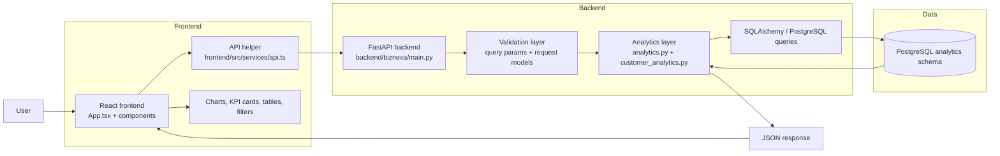

# BizNexa system diagram

## Diagram explanation

This diagram shows the real data path in BizNexa.

- The user interacts with the dashboard UI.
- The frontend sends HTTP requests through the central API helper.
- FastAPI validates the request and routes it to analytics functions.
- The analytics layer runs SQL against PostgreSQL.
- PostgreSQL returns aggregated business data.
- The frontend converts that data into cards, charts, and insight widgets.

## The most important principle

The frontend is not the source of truth for metrics. The backend and PostgreSQL are.
