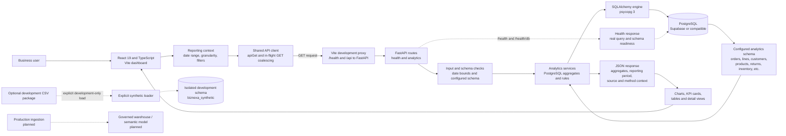

# BizNexa Data Flow Diagram

This diagram describes the current application runtime. Solid arrows represent the implemented read path. Dashed arrows indicate optional development or planned production paths; they are not part of normal application startup.

## Flow notes

1. Users select reporting context in the frontend. The frontend serializes supported context into HTTP query parameters.
2. In local development, Vite forwards `/health` and `/api` requests to FastAPI. A separately hosted frontend may use `VITE_API_BASE_URL`.
3. FastAPI validates route inputs and runs analytics service functions. SQLAlchemy/psycopg executes parameterized SQL against the schema selected by server-side `ANALYTICS_SCHEMA`.
4. Aggregations and business rules run in the backend/PostgreSQL path, not in the browser over downloaded raw customer transactions.
5. The API returns JSON. React renders the result with explicit loading, empty, and error states; it does not silently substitute fabricated data on request failure.
6. `/health` and `/health/db` execute a real database query and report schema readiness. They do not load or reset data.
7. Supabase PostgreSQL is treated as the runtime source of truth when configured. The optional CSV loader is separate, explicit, development-only, and targets an isolated schema; it is not automatically connected to the runtime analytics schema.

## Current analytics routes

- `GET /api/analytics/synthetic/overview`
- `GET /api/analytics/synthetic/sales`
- `GET /api/analytics/synthetic/customers`
- `GET /api/analytics/synthetic/customers/{customer_id}`
- `GET /api/analytics/synthetic/finance`
- `GET /api/analytics/synthetic/inventory`
- `GET /api/analytics/synthetic/suppliers`
- `GET /api/analytics/synthetic/decisions`

See the root [README](../README.md) for query parameters and local development commands. The `synthetic` route prefix reflects the current API contract and should not be interpreted as a trained predictive model.
