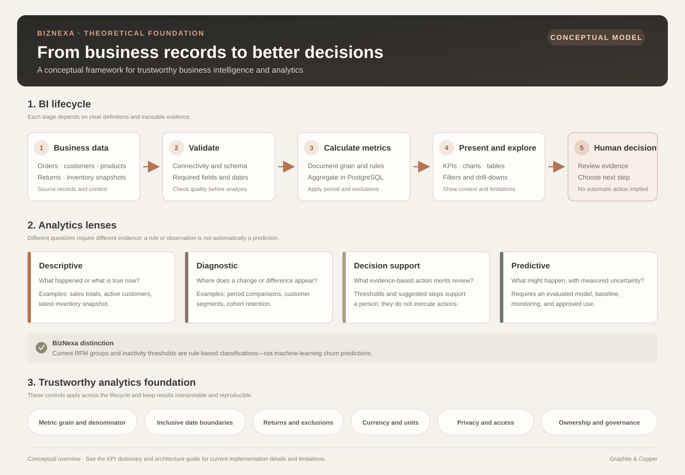

# BizNexa Theoretical Foundation

This guide explains the business-intelligence concepts behind BizNexa and how they relate to the current implementation. It is conceptual documentation, not a claim that every planned capability is already implemented. For the visual system flow, see the separate [Data Flow Diagram](./data-flow.md).

## Graphical overview



The graphic summarizes the theory in one view. It is a standalone SVG that can be opened or downloaded separately. The [Data Flow Diagram](./data-flow.md) focuses instead on the application's technical request and data path.

## 1. Business intelligence

Business intelligence (BI) turns operational records into structured information that supports monitoring, investigation, and decisions. A typical BI workflow includes:

1. **Source data** — business events and reference records such as orders, products, customers, returns, and inventory snapshots.
2. **Data validation** — checks that the database is reachable and the expected tables and columns exist.
3. **Metric calculation** — aggregation under explicit business rules, reporting periods, and units.
4. **Presentation** — dashboards, tables, comparisons, and drill-downs that let users inspect the results.
5. **Interpretation** — business owners evaluate the evidence and decide what action, if any, is appropriate.

BizNexa currently implements a read-only analytics path over the configured PostgreSQL schema. A production ingestion pipeline, authentication, tenant isolation, and approval of production KPI policies are not yet part of the current application.

## 2. Analytics categories

The application separates several kinds of analysis:

- **Descriptive analytics** summarizes what is present in the selected data, such as sales totals, customer counts, and inventory status.
- **Diagnostic analytics** supports investigation by comparing periods, segmenting records, and drilling into details.
- **Decision support** highlights records that meet documented thresholds and presents supporting evidence for review.
- **Predictive analytics** estimates future outcomes using an evaluated predictive model. BizNexa does not currently claim that its RFM classifications, inactivity rules, or threshold-based recommendations are machine-learning predictions.

These categories matter because an observed measurement, a screening rule, and a forecast have different levels of evidence and should not be presented as interchangeable.

## 3. Metrics, grain, and aggregation

Every metric should have a defined **grain**: what one source row or aggregate row represents. Examples include a sales-order line, a customer within a reporting period, or a product-location inventory snapshot.

Reliable aggregation follows several principles:

- Count distinct customer or order identifiers when the metric is an entity count.
- Sum additive measures only across compatible dimensions, time ranges, and currencies.
- Recalculate ratios from their aggregate numerator and denominator; do not average precomputed percentages unless the definition explicitly calls for it.
- Treat snapshots, such as inventory value, as point-in-time measures rather than summing balances across dates.
- State the date field that assigns an event to a period. A sale date and a return date can place related values in different reporting periods.
- Make inclusivity and exclusions explicit, including canceled orders, returns, missing values, and boundary dates.

BizNexa's current metric policies and implementation-specific definitions are maintained in the [KPI dictionary](./kpi-dictionary.md). They should be reviewed by business owners before being treated as production accounting or operational policy.

## 4. Reporting periods and comparison

A reporting period defines the population included in a calculation. Comparisons are meaningful only when their definitions and scopes are compatible. Common comparison approaches include:

- The immediately preceding period of equal duration.
- The same calendar period in the prior year.
- No comparison, when a baseline is unavailable or not useful.

An empty comparison period is not equivalent to a zero-valued business result. The UI should represent unavailable comparisons as unavailable rather than implying a percentage change from zero.

BizNexa passes reporting dates and supported granularity to API routes. The overview computes current and comparison aggregates in PostgreSQL. Customer analysis also supports customer-specific filters; the exact filters and definitions are documented in the KPI dictionary and API route contract.

## 5. Customer analysis concepts

Customer analytics uses multiple lenses that answer different questions:

- **Directory population** counts distinct customer IDs in the customer table.
- **Purchasing customers** counts customers with qualifying purchase history through an as-of date.
- **Period buyers** counts distinct customers with qualifying purchases during the selected period.
- **Lifecycle groups** describe whether a customer is new, returning, or has no purchase in the selected period. These categories are only a complete distribution when they are defined to be mutually exclusive.
- **Activity status** describes observed recency against an explicit inactivity threshold; it is not proof of future churn.
- **Cohort retention** groups customers by first qualifying purchase month and measures subsequent qualifying activity relative to each cohort's starting population.
- **RFM** describes purchasing behavior using Recency, Frequency, and Monetary measures. Rule-based score bands are classifications, not model probabilities.

These measures must retain their own denominators and time context. A directory count and period-buyer count can differ without either being wrong.

## 6. Decision-support theory

A useful decision-support item connects:

1. A clearly stated condition or rule.
2. A measured supporting value.
3. The records and period behind that value.
4. A possible next step for a human to review.
5. Limitations or assumptions that affect interpretation.

BizNexa's current Decision Center uses threshold-based recommendations returned by the backend. It does not execute operational changes or provide validated financial impact estimates. A recommendation is a review prompt, not an instruction or forecast.

## 7. Data quality and governance

Analytics quality depends on more than a successful query. Production use requires clear ownership and governance for:

- Source-system identity and duplicate resolution.
- Definitions for order status, qualifying purchases, returns, and refunds.
- Currency, time zone, fiscal calendar, and date cutoffs.
- Historical changes to product/customer attributes.
- Access control, tenant boundaries, privacy, and retention.
- Metric ownership, validation, versioning, and change communication.

The current health endpoints check database connectivity and the required analytics schema contract. These checks do not replace business validation, access controls, or production data governance.

## 8. Conceptual system model

At a conceptual level, BizNexa follows this path:

```text
Business records
    -> validated PostgreSQL schema
    -> backend metric definitions and aggregations
    -> API responses with reporting context
    -> dashboard visualizations and investigation
    -> human interpretation and decision
```

The separate [graphical data flow diagram](./data-flow.md) shows the current runtime path and distinguishes it from optional or planned development/production processes.

## 9. Further reading in this repository

- [Data flow diagram](./data-flow.md) — standalone visual view of the current system.
- [Architecture](./architecture.md) — implementation boundaries and current design decisions.
- [KPI dictionary](./kpi-dictionary.md) — metric rules, assumptions, and implementation status.
- [Synthetic dataset](./synthetic-dataset.md) — database table contract and development-data guidance.
